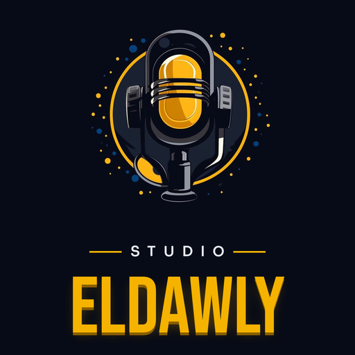

<p align="center"></p>

# Studio-Eldawly — استوديو الصوت العربي

تطبيق **Flutter** (أندرويد + ويب) لتحويل النص العربي لصوت احترافي بالذكاء الاصطناعي، باستخدام أصوات **Google Gemini TTS**.
التطبيق **مجاني بالكامل**: كل مستخدم بيحط مفتاح Gemini المجاني بتاعه، والمفتاح بيتحفظ مشفّر على جهازه بس.

## المميزات

| | |
|---|---|
| 🎙️ **192 شخصية صوتية** | 12 لهجة × 16 شخصية (رجل/سيدة × طفل/شاب/بالغ/مسن)، وكل شخصية مربوطة بصوت Gemini حقيقي مختلف من الـ30 صوت |
| 🎭 **8 مشاعر + شدة** | فرح، حماس، حزن، غضب، هدوء، خوف، دهشة، همس — لكل جملة لوحدها، وبـ3 درجات شدة |
| 🎚️ **ضبط الصوت** | السرعة، الطبقة، الدفء، وعمر الصوت |
| ✨ **إحساس تلقائي** | الذكاء الاصطناعي يقسّم النص ويختار الإحساس المناسب لكل جملة |
| 🗣️ **تحويل للهجة** | يحوّل أي نص فصحى للهجة المختارة قبل التسجيل |
| ⏸️ **علامات أداء** | وقفة، وقفة طويلة، ضحكة، تنهيدة، كحة جوّه النص |
| 🎧 **بودكاست** | يكتب حوار كامل من موضوع أو مقال لحد 4 متحدثين، ويوزّع الأصوات تلقائياً |
| 📝 **تفريغ صوت لنص** | من ملف صوت أو فيديو، مع طوابع زمنية اختيارية، وتحويله لتعليق صوتي |
| 🔁 **إعادة جملة واحدة** | تعمل نسخة جديدة من جملة من غير ما تعيد التسجيل كله |
| 💾 **كاش ذكي** | الجملة اللي اتولدت قبل كده بنفس الإعدادات ما بتتطلبش تاني (توفير للحصة المجانية) |
| 📴 **صوت احتياطي** | لو الحصة خلصت أو النت فصل، تسمع النص بصوت الجهاز |
| 🌗 **ثيمين** | فاتح (Lavender) وداكن (Neon) |

## التشغيل

```bash
# 1) مرة واحدة: توليد مجلدات أندرويد والويب وضبط اسم التطبيق وصلاحية الإنترنت
bash tool/ensure_platforms.sh

# 2) الحزم والأيقونات
flutter pub get
dart run flutter_launcher_icons

# 3) تشغيل
flutter run            # على موبايل أو محاكي
flutter run -d chrome  # ويب

# بناء
flutter build apk --release
flutter build web --release
```

### البناء التلقائي على GitHub
أول ما ترفع المشروع على GitHub، الـ workflow في `.github/workflows/build.yml` بيبني **APK** و**نسخة ويب** مع كل push.
تلاقيهم في تبويب **Actions** ← آخر تشغيل ← **Artifacts**.

## المعمارية

```
lib/
├── main.dart / app.dart          تشغيل التطبيق، الثيمين، اللغة العربية RTL
├── core/
│   ├── theme/                     الألوان (ThemeExtension) والخطوط
│   ├── router.dart                التنقل (go_router)
│   ├── storage/                   Hive (مشاريع + كاش صوت) و SecureStorage (المفتاح)
│   ├── audio/                     معالجة WAV (دمج، تحويل تردد، موجة) والمشغّل
│   └── settings/                  الإعدادات
├── data/
│   ├── catalog/                   اللهجات، المشاعر، الأعمار، كتالوج الأصوات
│   ├── gemini/                    الاتصال بـ Gemini: الصوت، النصوص، بناء توجيه الأداء
│   ├── production/                إنتاج مشروع كامل جملة بجملة ودمجه
│   ├── projects/                  نماذج المشاريع والحفظ
│   └── offline/                   صوت الجهاز الاحتياطي
├── features/                      الشاشات (الرئيسية، الأصوات، المحرر، النتيجة، البودكاست، التفريغ، الإعدادات)
└── widgets/                       مكونات الواجهة المشتركة
```

**الاعتمادية:** واجهة Gemini للصوت بتتغير. التطبيق بيجرّب أشكال الطلب المعروفة (Interactions API و generateContent)، ويفتكر اللي اشتغل لكل موديل، وبيختار تلقائياً أحسن موديل صوت متاح للمفتاح. ولو فيه خطأ حصة أو شبكة، بيعيد المحاولة تلقائياً.

## ملاحظات
- **صوت الطفل والمسن:** Gemini ما فيهوش أصوات أطفال مخصصة؛ بنقرّب الصوت بأصوات شبابية/ناضجة + توجيه أداء. النتيجة كويسة لكن مش مثالية زي ممثل حقيقي.
- **التصدير:** WAV بجودة كاملة (24kHz). MP3 مش متاح لسه.
- **الحصة المجانية** بيحددها Google لكل مفتاح، وممكن تكون محدودة على موديلات الصوت.

## الخطوط
Alexandria · Almarai · Sora · Bebas Neue — كلها برخصة SIL Open Font License (موجودة في `assets/fonts/`).
